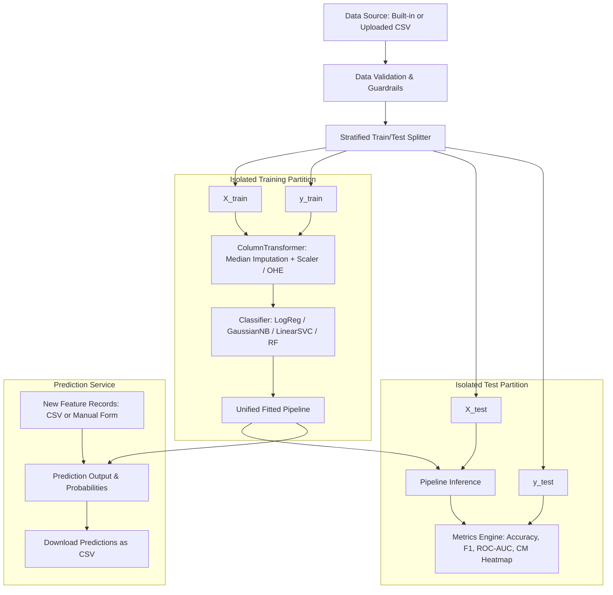

# Portfolio-Ready Machine Learning Classification System

[](https://www.python.org/)
[](https://fastapi.tiangolo.com/)
[](https://streamlit.io/)
[](https://scikit-learn.org/)
[](https://github.com/astral-sh/ruff)
[](https://pytest.org/)
[](LICENSE)

An end-to-end, portfolio-grade Machine Learning classification workbench and REST API. This application bridges mathematical derivations from scratch (NumPy) with production software engineering: modular scikit-learn preprocessing pipelines, zero-leakage validation, interactive Plotly visualizations, FastAPI microservices, and automated testing.

---

## 1. Problem Statement

Aspiring machine learning engineers often understand algorithm mathematics in isolated Jupyter Notebooks, or know how to call `model.fit()` without understanding production guardrails, data leakage, API integration, or deployment.

This project solves this gap by delivering an end-to-end classification system that:
1. **Guarantees Zero Data Leakage**: Enforces strict train/test splitting before fitting imputers and scalers.
2. **Empowers Model Comparisons**: Evaluates Gaussian Naive Bayes, Logistic Regression, Linear SVM, and Random Forest on identical data partitions.
3. **Emphasizes Clinical & Critical Metrics**: Focuses on positive-class recall (sensitivity) for cancer detection rather than misleading overall accuracy.
4. **Operates Without Database Overhead**: Manages in-memory fitted pipelines with random UUIDs and stateless inference.
5. **Provides Production Architecture**: Offers both a FastAPI REST backend and an interactive Streamlit UI, with automated fallback for single-container cloud hosting.

---

## 2. Features

- **Interactive Dataset Explorer**:
  - Built-in Breast Cancer Wisconsin dataset (569 samples, 30 features).
  - Custom CSV file upload with validation guardrails (row/column limits, empty checks, missing values, infinite values, single-class detection).
  - Interactive target column and feature selection.
- **Leakage-Free Preprocessing**:
  - Independent train/test splitting (`stratified=True` when viable).
  - Encapsulated `ColumnTransformer` with median imputation, standard scaling, and one-hot encoding for categorical variables.
- **Multi-Algorithm Comparison**:
  - Trains and benchmarks **Gaussian Naive Bayes**, **Logistic Regression**, **Linear SVM (LinearSVC)**, and **Random Forest** on identical test partitions.
  - Interactive side-by-side Plotly bar chart and sortable comparison table.
- **Comprehensive Evaluation**:
  - Accuracy, Macro Precision/Recall/F1, Weighted F1, Per-Class Support.
  - Malignant-Class Precision & Sensitivity (Recall) reporting.
  - Annotated Confusion Matrix Heatmap, ROC Curve with AUC score, and Precision-Recall Curve.
- **Inference & Prediction Engine**:
  - **Batch CSV Inference**: Upload new feature files, validate schema, apply fitted pipeline, and download predictions as CSV.
  - **Manual Record Prediction**: Real-time form for single-record prediction with probability breakdowns or signed decision scores.
- **FastAPI REST Service**:
  - Full OpenAPI / Swagger documentation (`/docs`).
  - Strict Pydantic v2 validation and structured JSON error responses (no stack traces leaked).
- **Dual Execution Modes**:
  - Works as a distributed microservice setup (FastAPI + Streamlit) or standalone single-process application for free hosting.

---

## 3. Technology Stack

- **Core Language**: Python 3.11+ (tested on Python 3.13)
- **Machine Learning**: `scikit-learn`, `numpy`, `pandas`
- **REST API**: `FastAPI`, `uvicorn`, `pydantic`
- **Dashboard & UI**: `Streamlit`, `plotly`
- **Testing & QA**: `pytest`, `httpx` (TestClient)
- **Code Quality**: `ruff` (linter and formatter)

---

## 4. Architecture Diagram



---

## 5. Project Folder Structure

```text
ml-classification-system/
├── app.py                      # Main Streamlit dashboard application
├── pyproject.toml              # Project metadata, pytest, and ruff configuration
├── requirements.txt            # Pinned runtime and development dependencies
├── LICENSE                     # MIT License
├── .gitignore                  # Git hygiene exclusions
├── .env.example                # Safe environment configuration template
├── README.md                   # Comprehensive project documentation
├── docs/                       # Detailed architectural and user guides
│   ├── architecture.md         # Layered design, data flow, and privacy
│   ├── model-comparison.md     # Mathematical comparison and executed benchmark
│   ├── api-guide.md            # REST API reference and cURL examples
│   ├── deployment.md           # Free hosting deployment guide (Streamlit / Render)
│   └── screenshots/            # Real screenshot capture instructions
│       └── README.md
├── notebooks/                  # Stage 1 & 2 educational reference
│   └── README.md
├── reports/                    # Historical model comparison reports
│   └── model_comparison_report.md
├── src/
│   └── ml_app/                 # Core Python package
│       ├── __init__.py
│       ├── config.py           # Application constants and settings
│       ├── exceptions.py       # Domain-specific custom exceptions
│       ├── logging_config.py   # Safe, structured logging
│       ├── data/
│       │   ├── __init__.py
│       │   ├── loader.py       # Built-in and CSV loaders
│       │   └── validation.py   # Guardrails and dataset summary
│       ├── preprocessing/
│       │   ├── __init__.py
│       │   └── pipeline.py     # Leakage-free preprocessor & splitting
│       ├── models/
│       │   ├── __init__.py
│       │   ├── registry.py     # Algorithm metadata & parameter contracts
│       │   ├── factory.py      # Pipeline creation & parameter validation
│       │   └── scratch_models.py # NumPy reference (Stage 1 & 2 with bias fix)
│       ├── evaluation/
│       │   ├── __init__.py
│       │   └── metrics.py      # Metrics, CM, ROC, and PR curves
│       ├── services/
│       │   ├── __init__.py
│       │   ├── training_service.py   # Model training & in-memory store
│       │   └── prediction_service.py # Batch & single-record inference
│       ├── api/
│       │   ├── __init__.py
│       │   ├── main.py         # FastAPI application factory
│       │   ├── dependencies.py # Service injection singletons
│       │   ├── schemas.py      # Pydantic v2 request/response schemas
│       │   └── routes/
│       │       ├── __init__.py
│       │       ├── health.py
│       │       ├── datasets.py
│       │       ├── models_routes.py
│       │       ├── training.py
│       │       └── predictions.py
│       └── ui/
│           ├── __init__.py
│           ├── api_client.py   # Client with automatic direct-service fallback
│           └── components.py   # Plotly charts & UI scorecards
└── tests/                      # Automated test suite (31 tests)
    ├── conftest.py
    ├── test_api_health.py
    ├── test_api_predictions.py
    ├── test_api_training.py
    ├── test_data_validation.py
    ├── test_metrics.py
    ├── test_models.py
    └── test_preprocessing.py
```

---

## 6. Installation & Quickstart

### Prerequisites
- Python 3.11, 3.12, or 3.13 installed.
- Git installed.

### Windows (PowerShell)
```powershell
# 1. Clone repository and navigate inside
git clone https://github.com/your-username/ml-classification-system.git
cd ml-classification-system

# 2. Create virtual environment
python -m venv .venv
.\.venv\Scripts\Activate.ps1

# 3. Install dependencies
pip install -r requirements.txt
```

### macOS / Linux (Bash)
```bash
# 1. Clone repository and navigate inside
git clone https://github.com/your-username/ml-classification-system.git
cd ml-classification-system

# 2. Create virtual environment
python3 -m venv .venv
source .venv/bin/activate

# 3. Install dependencies
pip install -r requirements.txt
```

---

## 7. How to Run Locally

### Option A: Run the Streamlit Dashboard (Standalone Direct Mode)
In standalone mode, Streamlit directly invokes the Python service layer in memory without needing an external API server:
```bash
streamlit run app.py
```
Open your browser at `http://localhost:8501`.

### Option B: Run Both FastAPI and Streamlit (Full Microservice Architecture)

**Terminal 1 (Start FastAPI REST API):**
```bash
uvicorn ml_app.api.main:app --host 127.0.0.1 --port 8000 --reload
```
Interactive API documentation is now live at `http://127.0.0.1:8000/docs`.

**Terminal 2 (Start Streamlit UI):**
```bash
streamlit run app.py
```
The Streamlit sidebar will automatically indicate `🟢 API Connected: v1.0.0`.

---

## 8. Automated Testing & Code Quality

### Running Tests
Execute the full pytest test suite (31 tests):
```bash
pytest
```
*Actual executed result: `31 passed in 2.70s`.*

### Running Linter & Formatter Checks
```bash
# Lint checks
ruff check src tests app.py

# Format checks
ruff format --check src tests app.py
```
*Actual executed result: `40 files already formatted. All checks passed!`*

---

## 9. Real Executed Model Comparison Results

Evaluated on the **Breast Cancer Wisconsin (Diagnostic)** dataset ($n=569$, $80/20$ stratified split, $n_{\text{test}}=114$, `random_state=42`):

| Classifier | Test Accuracy | Macro F1 | Malignant Precision | Malignant Recall (Sensitivity) | Malignant F1 | ROC AUC |
| :--- | :---: | :---: | :---: | :---: | :---: | :---: |
| **Logistic Regression** | **98.25%** | **0.9812** | **97.62%** | **97.62%** | **0.9762** | **0.9954** |
| **Linear SVM (LinearSVC)** | 96.49% | 0.9623 | 95.24% | 95.24% | 0.9524 | 0.9927 |
| **Random Forest** | 95.61% | 0.9526 | 95.12% | 92.86% | 0.9398 | 0.9937 |
| **Gaussian Naive Bayes** | 93.86% | 0.9337 | 92.68% | 90.48% | 0.9157 | 0.9878 |

> **Key Clinical Takeaway**:
> For cancer screening, **Malignant Recall (97.62%)** is paramount to avoid life-threatening false negatives. Logistic Regression delivered the highest sensitivity and calibration.

---

## 10. Educational Audit: The Linear SVM Bias Gradient Correction

During our Stage 2 audit, we examined the soft-margin hinge loss formulation:
$$\min_{w, b} \mathcal{L}(w, b) = \frac{1}{2} \|w\|^2 + C \cdot \frac{1}{n} \sum_{i=1}^n \max\left(0, 1 - y_{\text{signed}}^{(i)}(w^T x^{(i)} + b)\right)$$

On active margin violations ($\text{active} = \{i : 1 - y_{\text{signed}}^{(i)}(w^T x^{(i)} + b) > 0\}$), the subgradient with respect to bias $b$ is:
$$\frac{\partial \mathcal{L}}{\partial b} = -\frac{C}{n} \sum_{i \in \text{active}} y_{\text{signed}}^{(i)}$$

Omitting the $\frac{1}{n}$ factor causes bias updates to scale with batch size, leading to numerical divergence. Our verified scratch implementation in `src/ml_app/models/scratch_models.py` explicitly normalizes this subgradient.

---

## 11. Known Limitations & Privacy

- **In-Memory Models**: Models are held in process RAM without persistent database storage. Restarting the process resets stored model IDs.
- **Privacy Assurance**: Uploaded CSV files are parsed transiently in memory and never written to permanent disk storage. No raw data rows are written to server log files.
- **Medical Disclaimer**: This application is strictly an educational tool and is **not certified for medical diagnosis**.

---

## 12. Free Deployment Guide

See [docs/deployment.md](docs/deployment.md) for step-by-step instructions to deploy to:
- **Streamlit Community Cloud** (Zero-cost, 1-click GitHub deployment).
- **Hugging Face Spaces** (Streamlit SDK).
- **Render** (FastAPI backend).

---

## 13. License

Distributed under the [MIT License](LICENSE).
