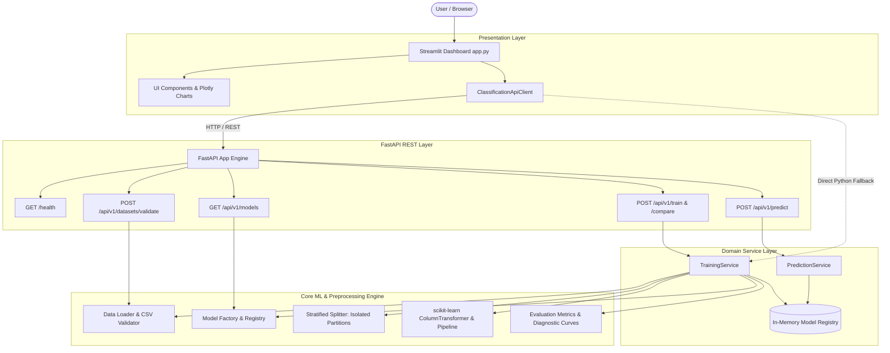

# System Architecture & Technical Design

## 1. Overview

The **Machine Learning Classification Workbench** is built using a clean, layered modular architecture. It supports dual-execution modes:
1. **Integrated / Full-Stack Mode**: Streamlit frontend communicating over HTTP with a FastAPI backend REST API.
2. **Standalone / Embedded Mode**: Streamlit frontend executing the core domain services directly in Python memory (ideal for single-container free hosting on Streamlit Community Cloud or Hugging Face Spaces).

---

## 2. Zero Data Leakage Guarantee

Data leakage occurs when information from outside the training dataset is used to create or tune the model. In classification systems, fitting scalers or imputers on the full dataset before splitting leaks the test set distribution into the training set, producing overly optimistic evaluation metrics.

### Our Pipeline Guarantee:
1. **Strict Partitioning First**: Raw data is split into $X_{\text{train}}, X_{\text{test}}, y_{\text{train}}, y_{\text{test}}$ via `prepare_and_split_data()` **before** any preprocessor is constructed or fitted.
2. **Encapsulated Preprocessor**: Transformers (`SimpleImputer`, `StandardScaler`, `OneHotEncoder`) are combined inside a `scikit-learn.pipeline.Pipeline`.
3. **Training-Only Fit**: `pipeline.fit(X_train, y_train)` computes statistics (e.g. median, feature mean, feature standard deviation) exclusively on $X_{\text{train}}$.
4. **Frozen Evaluation**: When `pipeline.predict(X_test)` runs, the test partition is transformed strictly using the training statistics without updating them.
5. **Inference Consistency**: When predicting on new user CSV or manual records, the identical fitted pipeline is applied without refitting.

---

## 3. In-Memory Registry & Process Lifecycle

To keep the application simple and eliminate external database dependencies:
- Fitted pipelines are retained in an in-memory dictionary (`_artifacts: dict[str, ModelArtifact]`).
- Each fitted model is assigned a random UUID (e.g., `43409ae9-2047-46d0-9c6f-a57b49cba8bf`).
- Prediction requests supply this `artifact_id`.
- If the backend process restarts (e.g., free-tier dyno recycling), stored artifacts are cleared. The application returns a descriptive `404 ModelNotFoundError`, prompting the user to retrain the model.

---

## 4. Privacy & Ephemeral Data Processing

- **No Permanent Storage**: Uploaded dataset files and inference requests are parsed into memory (`io.BytesIO`) and discarded after processing.
- **No Disk Logging of Sensitive Rows**: Log messages record only dataset dimensions (rows, columns) and validation status; feature row contents and user data are never written to server log files.
